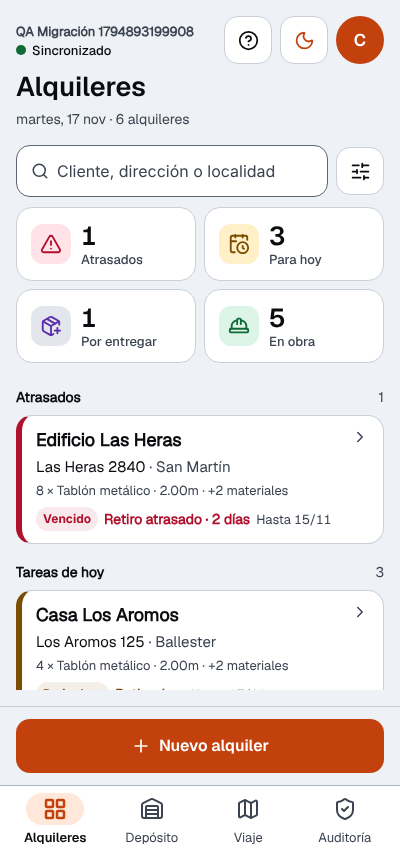
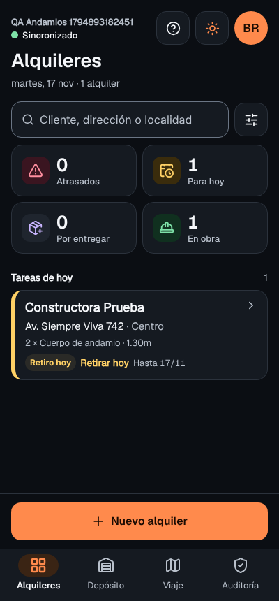
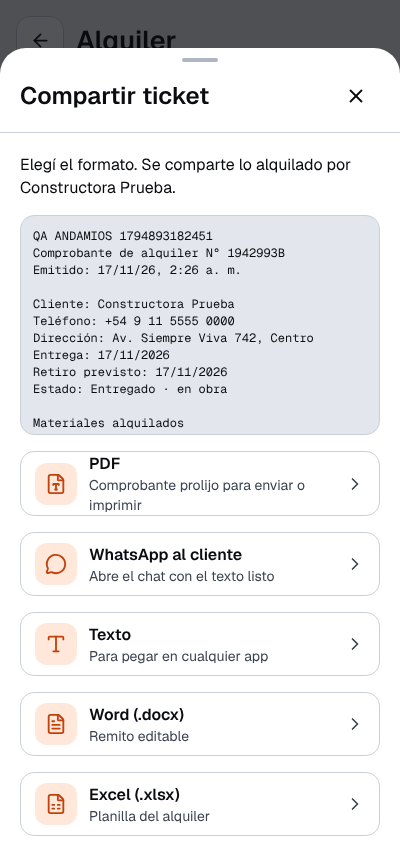

<p align="center">
  
</p>

<h1 align="center">Chema Andamios</h1>

<p align="center">
  App Android para el alquiler de andamios: entregas, retiros, depósito y viajes,<br/>
  con todo el equipo sincronizado, auditoría de cada cambio y tickets profesionales.
</p>

<p align="center">
  <a href="descargas/LEEME.md"><b>Descargar APK 1.0.0</b></a> ·
  <a href="docs/MANUAL.md">Manual de uso</a> ·
  <a href="docs/ARQUITECTURA.md">Arquitectura</a> ·
  <a href="docs/SEGURIDAD.md">Seguridad</a> ·
  <a href="docs/CAMBIOS.md">Cambios</a>
</p>

---

## Funciones

| | |
|---|---|
| **Equipo sincronizado** | Todos los teléfonos con el mismo código de equipo ven y cargan los mismos datos. Funciona sin señal y sincroniza solo. |
| **Ingreso por nombre** | Cada persona elige su nombre; no hay contraseñas. |
| **Auditoría** | Cada cambio queda registrado con persona, fecha, hora y materiales movidos. No se puede borrar desde la app. |
| **Alquileres** | Cliente, carga, entrega, retiro con faltantes/daños, reingreso, fotos y recordatorios. |
| **Depósito** | Stock en depósito, en obra, en taller y perdido; ajustes y movimientos con motivo. |
| **Viaje** | Recorrido del día ordenado y abierto en Google Maps. |
| **Tickets** | PDF profesional, WhatsApp al cliente, texto, Word o Excel. |
| **Copias** | Exportar/importar todo en JSON (con fotos y auditoría). |
| **Sol y Noche** | Tema de alto contraste para la calle y tema oscuro. |
| **Guía** | Guía de uso por secciones dentro de la app, exportable en PDF. |

<p align="center">
  
  
  
</p>

## Estructura

```
app/                 Pantallas (Expo Router)
src/
  components/        Componentes de interfaz
  context/           Sesión (equipo + nombre), inventario sincronizado, tema, avisos
  sync/              Sincronización: API del servidor, almacenamiento local, cola y réplica
  domain/            Reglas de negocio puras (motor de operaciones, validaciones)
  documents/         Generadores de remito Word y reporte Excel
  services/          Fotos, archivos, copias, tickets, viaje, avisos
  data/              Lectura de datos de la app anterior (migración)
  theme/             Colores y tipografía (Sol / Noche)
supabase/migrations/ Esquema y funciones del servidor
tests/               Pruebas unitarias (Vitest) y de punta a punta (Playwright)
scripts/             Compilación web/Android, servidor local, limpieza de QA, respaldo
descargas/           APK publicado y verificación SHA-256
docs/                Manual, arquitectura, seguridad, cambios y capturas
```

## Desarrollo

Requisitos: Node 22+, npm. Para Android: JDK 21 (y JDK 17 para plugins de Gradle), Android SDK 36, build-tools 36.0.0, NDK 27.1.12297006, CMake 3.22.1.

```bash
npm ci
npm run check                 # tipos + lint + pruebas unitarias
npm run build:web && npm run preview   # versión web de prueba en http://localhost:8081
npm run test:ui -- --trace off         # recorrido real con dos teléfonos (crea equipos "QA …")
npm run qa:cleanup            # borra los equipos "QA …" (requiere SUPABASE_ACCESS_TOKEN)
npm run build:android         # APK ARM64 verificado (firma, paquete y versión)
```

No hay variables de entorno obligatorias ni claves secretas en el proyecto. Ver [Seguridad](docs/SEGURIDAD.md).

## Licencia

Software privado de Chema Andamios. Todos los derechos reservados.
