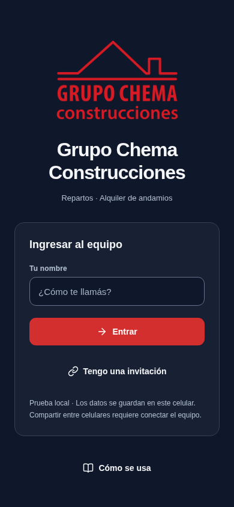
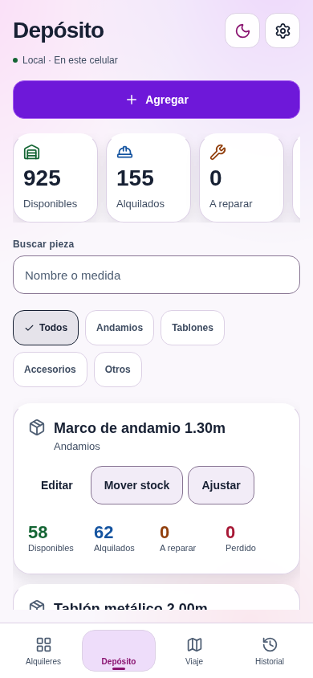
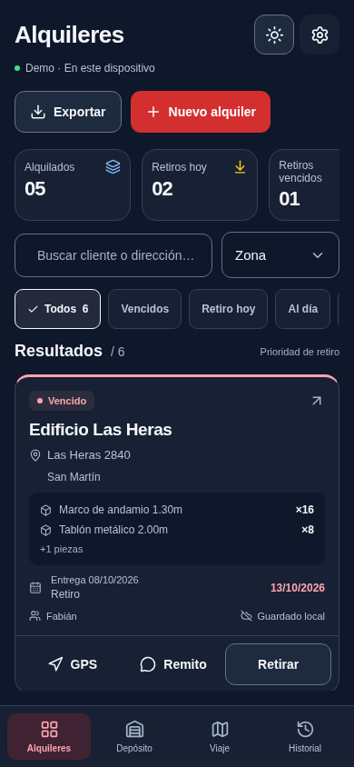
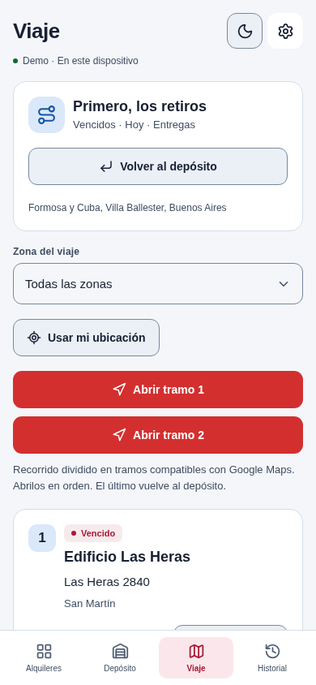

# Repartos Chema 1.1.0 — entrega del15/10/2026

[**Descargar APK nuevo, privado**](https://github.com/kkshiiit/repartos-chema/raw/refs/heads/descargas/android/v1.1.0-demo.2/repartos-chema-demo-arm64.apk). Si no descarga directamente, abrir [la ficha](https://github.com/kkshiiit/repartos-chema/blob/descargas/android/v1.1.0-demo.2/repartos-chema-demo-arm64.apk) y tocar Download raw file. Requiere cuenta con acceso al repositorio.

## Qué cambió

La interfaz anterior comprimía el nombre de las piezas entre botones, repetía el selector de tema en ventanas y usaba lemas y terminología de obras que el usuario rechazó. Esta entrega usa Alquileres, Depósito, Viaje e Historial; el logo real y un ingreso por nombre. La bienvenida explica cuatro pasos y se puede repetir desde Ajustes.

- Depósito: Agregar, Disponibles, Alquilados y A reparar. Nombre en fila completa; acciones debajo. Tarjetas, bordes y espacios consistentes.
- Alquileres: búsqueda, zona y estados; sin Cerradas independiente. No hay avatarAD ni selector de roles. Los roles técnicos se conservan para compatibilidad y protección del dominio.
- Tema: Claro/Oscuro/Sistema persistentes. Un botón en las secciones principales y selector completo en Ajustes; las ventanas no repiten el botón.
- Entrega: campo Recibió, separado del flete; queda en datos, detalle, WhatsApp y Word, con reversión compatible.
- Viaje: vencidos/hoy antes de entregas; orden manual o cercanía dentro de prioridades. Recorrido numerado por Google Maps, dividido si supera los límites de paradas, con vuelta al depósito real indicado por el usuario. No promete recorrido vial óptimo ni cálculo de tráfico.
- Equipo: nombre e invitaciones; el propietario interno gestiona invitaciones y bajas. La demo sigue siendo local. El backend real está preparado y probado en emuladores; conectar celulares requiere Firebase real y despliegue autorizado.

## Capturas reales revisadas

Inicio con logo y nombre:

Depósito claro, nombres sin comprimir:

Alquileres oscuro:

Viaje claro:

Las 48 capturas de pantallas principales incluyen390 y1440px, claro/oscuro. La guía tiene captura adicional. La matriz de pruebas también revisó320,360 y768px. Son capturas Chromium de la app funcionando; no son pruebas de hardware Android ni una certificación completa de accesibilidad.

## Verificaciones ejecutadas

| Comando | Resultado |
|---|---|
| npm run check |88 pruebas unitarias, typecheck, lint sin errores y Functionsbuild correctos; queda un warning lint del import de axe |
| Emuladores Firestore/Storage con configuración de integración |18/18 correctas; reglas y handlers con contexto Auth controlado, no transporte público ni emisión real de tokens |
| npm run build:web |Exportación correcta; worker local, FCM no activado |
| npm run test:ui -- --workers=2 |21/21 correctos en 5,5 min; documentos, inventario, recuperación, temas, bienvenida, participantes y axe |
| npm run test:ui -- tests/ui/trip.spec.ts --workers=1 |1/1 correcto en 8 s sobre la exportación final tras corregir recarga del depósito desde Ajustes |
| npm run build:android:demo |APK real generado, Gradle completo correcto en14 min 2 s y corrección incremental correcta en2 min 23 s; no se probó físicamente |
| apksigner, aapt, CRC y SHA256 |FirmaAPK v2 válida, mismo certificado que1.0, paquete com.grupochema.repartos, versionName 1.1.0/versionCode 2, Android 7+, ARM64 |

La primera ejecución UI tuvo cinco fallos de selectores/ambigüedad y regeneración de dist durante la última pantalla. Se ajustaron los selectores a la interfaz vigente y se repitió la suite con la exportación estable:21/21. La recarga del depósito se verificó con una prueba específica posterior; no se hizo pasar una prueba fallida como correcta. Logs en artifacts/validacion/rediseno-*.

APK 49.474.956bytes. SHA256 **4dec382aa887c0e20a9bfead6f12d503400065a4e911cd8a714c9803aa8a13d9**. No solicita micrófono, superposición ni identificador publicitario. Firma de prueba; no es firma productiva administrada. Instalar sobre la versión anterior, sin desinstalar ni borrar datos, tras guardar copiaJSON.

## Seguridad, rendimiento y límites

No se añadieron dependencias visuales ni animaciones. Logo estático transparente; no hay blur continuo. Se mantienen listas virtualizadas y carga diferida de documentos. No se midieron FPS, RAM ni batería en Android físico. Métricas de archivos web en artifacts/validacion/rediseno-metricas.json, sin atribuir una mejora de velocidad no medida. No se repitió npm audit porque las dependencias no cambiaron; los avisos transitivos documentados antes siguen siendo riesgos pendientes.

Invitaciones cloud:32 bytes aleatorios, SHA256 en servidor, un uso, 24 h y límite por UID para intentos inválidos. Bajas auditadas y validadas por backend/reglas. Una sesión offline puede conservar datos que ya conocía; no se promete borrado remoto. El propietario inicial se provisiona con credenciales administrativas fuera de la app, sin reclamación abierta. Falta configurar Auth anónimo, proyecto Firebase, reglas/Functions reales y controles productivos de abuso. Ver FIREBASE.md. No se activó facturación ni se desplegó producción.

La demo solo comparte información entre nombres en este dispositivo; una invitación local no vincula celulares. El usuario recibió una pregunta para indicar si existe un proyecto Firebase. Recuperación del propietario ante pérdida de teléfono y pruebas multiusuario físicas siguen pendientes.

Motion Sites no está disponible en los MCP/configuración de este entorno; no se utilizó ni se afirmó su uso. Se siguieron guías de diseño y validación visual. No se creó un archivo Figma ni un sitio externo para acreditar las capturas.

## Recuperación y entrega

Código en main del repositorio privado kkshiiit/repartos-chema. APK en rama descargas, ruta android/v1.1.0-demo.2; el APK anterior se conserva. Fuente y web se empaquetan con manifiestos/restauración, y el punto exacto queda en CONTINUIDAD_REDISENO.md. El entorno no tiene reanudación automática confirmada. No hay publicación en tiendas ni URL web pública.

## Comprobación final de invitaciones en Android

La inspección del URL global de React Native 0.86 mostró que su extracción de hostname/path se limita a HTTP. Se añadió una prueba que reproduce un parser incompleto, falló antes del cambio y pasó al reemplazar el análisis de enlaces propios por un formato cerrado con64 hexadecimales. Admite los formatos canónicos de dos/tres barras y rechaza otros destinos. No se añadió una dependencia.

Después de esa corrección se ejecutó check de nuevo:88/88, tipos/lint/Functions correctos. Se regeneraron web y APK. Se revalidaron los tres recorridos afectados (bienvenida, invitación/baja y depósito):3/3 en 10,9 s. Hay22 recorridos UI únicos comprobados entre la suite21/21 y la prueba de depósito posterior. No se afirma una ejecución única de22 sobre hardware. Los resultados anteriores se conservan como evidencia de las partes sin cambios.

APK definitivo: candidato v1.1.0-demo.2, mismo versionName 1.1.0/versionCode 2 y mismo certificado que1.0. La primera copia1.1 se conserva como candidato anterior; descargar la ruta demo.2 enlazada arriba. La recuperación independiente desde GitHub verificó SHA256/CRC; el uso físico queda pendiente.
