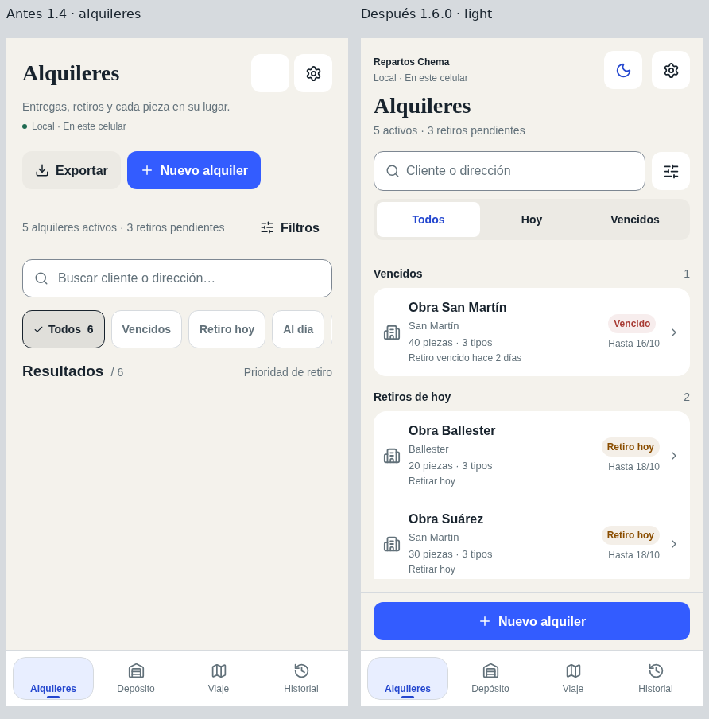

# Galería real — estructura 1.5

Capturas actuales de Chromium con datos sintéticos aislados. No son diseños generados ni pruebas en hardware Android. La [comparación de estructura](COMPARACION_VISUAL_1_5.md) describe tamaños, datos, revisión y diferencias intencionales; los resultados funcionales se entregan por separado.

## Referencia y app al mismo tamaño

| Superficie | Comparativa |
|---|---|
| Alquileres | [Referencia / aplicación clara](../artifacts/capturas/estructura-1.5/comparacion-referencia-alquileres.png) |
| Depósito | [Referencia / aplicación clara](../artifacts/capturas/estructura-1.5/comparacion-referencia-deposito.png) |
| Viaje | [Referencia / aplicación clara](../artifacts/capturas/estructura-1.5/comparacion-referencia-viaje.png) |
| Historial | [Referencia / aplicación clara](../artifacts/capturas/estructura-1.5/comparacion-referencia-historial.png) |
| Detalle | [Referencia / aplicación oscura](../artifacts/capturas/estructura-1.5/comparacion-referencia-detalle.png) |
| Nuevo alquiler | [Referencia / aplicación oscura](../artifacts/capturas/estructura-1.5/comparacion-referencia-nuevo.png) |
| Carga preparada | [Referencia / aplicación oscura](../artifacts/capturas/estructura-1.5/comparacion-referencia-carga.png) |
| Retiro abierto | [Referencia / aplicación oscura](../artifacts/capturas/estructura-1.5/comparacion-referencia-retiro.png) |
| Ajustes | [Referencia / aplicación clara](../artifacts/capturas/estructura-1.5/comparacion-referencia-ajustes.png) |
| Combos | [Referencia / aplicación clara](../artifacts/capturas/estructura-1.5/comparacion-referencia-combos.png) |
| Documentos | [Referencia / aplicación clara](../artifacts/capturas/estructura-1.5/comparacion-referencia-documentos.png) |

## Antes y después con el mismo fixture

430×840, seis alquileres de ejemplo, fecha fija18/10/2026. Las versiones anteriores no se sustituyen por estas capturas.

| Pestaña | Claro | Oscuro |
|---|---|---|
| Alquileres | [Antes/después](../artifacts/capturas/estructura-1.5/comparacion-antes-despues-alquileres-light.png) | [Antes/después](../artifacts/capturas/estructura-1.5/comparacion-antes-despues-alquileres-dark.png) |
| Depósito | [Antes/después](../artifacts/capturas/estructura-1.5/comparacion-antes-despues-deposito-light.png) | [Antes/después](../artifacts/capturas/estructura-1.5/comparacion-antes-despues-deposito-dark.png) |
| Viaje | [Antes/después](../artifacts/capturas/estructura-1.5/comparacion-antes-despues-viaje-light.png) | [Antes/después](../artifacts/capturas/estructura-1.5/comparacion-antes-despues-viaje-dark.png) |
| Historial | [Antes/después](../artifacts/capturas/estructura-1.5/comparacion-antes-despues-historial-light.png) | [Antes/después](../artifacts/capturas/estructura-1.5/comparacion-antes-despues-historial-dark.png) |

## Pantallas y ventanas adicionales

[Todos los originales](../artifacts/capturas/estructura-1.5/), [matriz320/360/390/412 y texto200%](../artifacts/capturas/estructura-1.5/matriz/), [selectores, ajustes de pieza, combo, fotos, coordenadas y revisión JSON](../artifacts/capturas/estructura-1.5/superficies/).

En el repositorio privado hay que iniciar sesión para abrir las imágenes. Cada enlace permite ampliar el PNG original desde el celular. Las capturas muestran el color real de la app; no fueron recoloreadas para la presentación.
